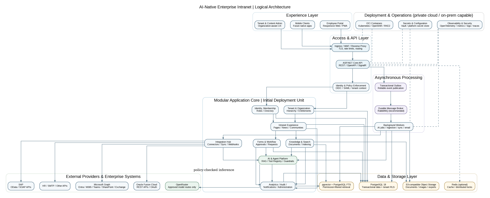
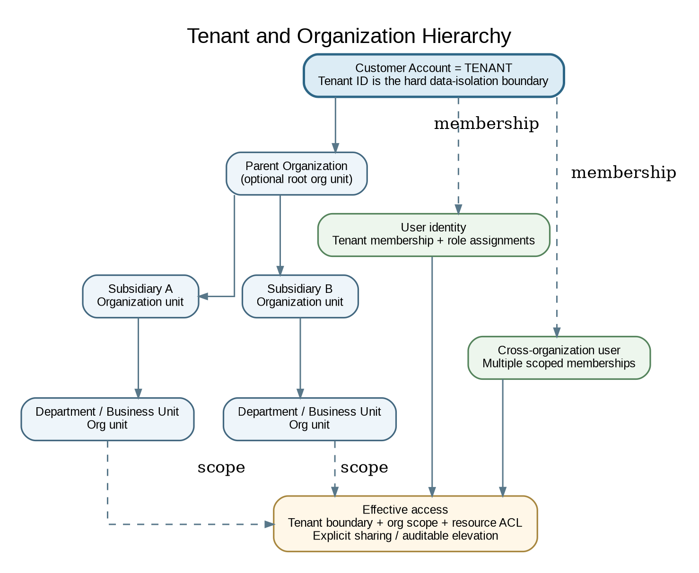
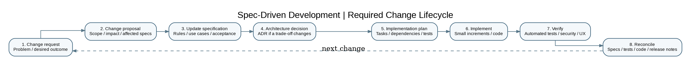

**Document status:** Architecture and product baseline for project initiation  \  
**Version:** 0.1  \  
**Audience:** Product owner, engineering leadership, solution architects, UX, security, delivery, and AI coding agents  \  
**Working product name:** To be confirmed


# 1. Executive summary

The product is an AI-native digital workplace and enterprise intranet for corporate, enterprise, and government organizations. It combines employee communications, knowledge and document management, people and organization experiences, social engagement, forms and workflows, enterprise integrations, analytics, and AI assistants and agents in one extensible platform.

The product must be sold through three commercial packages while keeping a common product core. AI must be available in every package. Package differentiation should be based on capacity, administration depth, automation sophistication, integration breadth, governance, and service levels, rather than making AI a premium-only capability.

The core tenancy model is:

- A **Customer Account** is the **Tenant** and the hard boundary for customer data, configuration, policy, and entitlements.
- A tenant can own multiple **Organization Units**.
- Organization Units can form a hierarchy containing parent organizations, subsidiaries, departments, divisions, and business units.
- Users can hold memberships in one or more organization units within a tenant, with scoped roles and permissions.
- A person may belong to more than one tenant only through explicit, separate tenant memberships. No tenant membership implies access to another tenant.

**Proposed technical baseline:** React with Next.js 16.x for the web experience; ASP.NET Core on .NET 10 LTS for the application/API; PostgreSQL 18 as the primary database; pgvector for the initial vector-search capability; S3-compatible object storage; a durable message broker for asynchronous work; and OCI containers for repeatable private-cloud and on-premises deployment.

**Proposed architecture style:** a modular monolith with strict domain boundaries, versioned APIs, background worker processes, transactional outbox, and a provider/connector adapter model. Do not start with a fleet of microservices. Extract modules into independently deployed services only when measurable scaling, security, availability, or release requirements justify the additional operational complexity.

**AI provider baseline:** OpenRouter is the initial external AI gateway. The product must call it only through an internal AI Gateway abstraction. Model and provider selection must be governed by tenant-level data-classification policies. A local-model adapter should be architecturally possible, but local inference is not assumed to be in the first release.

**Authentication sequence:** temporary username/password authentication may exist only in isolated development/test builds. It must be removed before production release. Production identity should use standards-based federation, with Microsoft Entra ID and Google Workspace among the first supported identity systems. OIDC is the default for new integrations; SAML 2.0 should be supported where required by enterprise customers.

This document should be treated as **Foundation v0.1**. It is deliberately decisive where a sound default is available, and explicit where product or commercial validation is still required.

# 2. Product definition

## 2.1 Product vision

To become the trusted, intelligent digital workplace where every employee can discover knowledge, connect with people, complete work, and access organizational services through one secure and personalized experience.

## 2.2 Product mission

Enable organizations to create a connected, productive, and governed employee experience by unifying communications, knowledge, collaboration, workflows, enterprise systems, and responsible AI in a configurable intranet platform that can operate in private-cloud and on-premises environments.

## 2.3 Product promise

One configurable employee experience. One governed knowledge and AI layer. One organization-aware platform. Deployable in the environment required by the customer.

## 2.4 Target customers

**Primary:** medium-to-large corporate organizations, large enterprises, and government entities.

**Buying stakeholders:** CIO/CTO, CHRO, Head of Internal Communications, Digital Workplace leader, IT Applications leader, Information Security, Enterprise Architecture, Data/AI leadership, and procurement.

**User groups:** employees, managers, HR teams, communications teams, content owners, department administrators, IT/service teams, tenant administrators, and platform operators.

## 2.5 Core value propositions

1. **One employee front door:** a consistent entry point for news, knowledge, people, services, requests, and applications.
2. **AI grounded in authorized knowledge:** contextual answers and actions that respect the user's tenant, organization, and content permissions.
3. **Organization-aware by design:** subsidiaries, departments, and business units operate under one tenant without losing their own governance and experience.
4. **Enterprise integration:** connect the intranet to collaboration, identity, HR, ERP, and business applications rather than attempting to replace them.
5. **Deployment choice:** run the same product in a private cloud or on premises, with a future option for a shared SaaS control plane where commercially appropriate.
6. **Configurable commercial tiers:** sell a shared product core in three packages, with usage, capability, and governance entitlements enforced centrally.

## 2.6 Product boundaries

The intranet is an employee experience and orchestration layer. It is not intended to become a replacement for a customer's HRIS, ERP, document-management system, identity provider, or enterprise collaboration suite. It may surface information, initiate workflows, search authorized content, and orchestrate approved actions in those systems through supported APIs.

The product must distinguish between:

- **Native product data:** pages, news, communities, workflows, settings, and product-managed knowledge.
- **Connected source data:** information retrieved or indexed from SharePoint, Oracle Fusion, SAP, HR systems, and other applications.
- **Derived AI data:** embeddings, summaries, recommendations, classifications, and agent outputs, each retaining source references, tenant scope, and authorization metadata.

# 3. Product principles

1. **AI-native, not AI-dependent:** AI enriches every major experience, but core navigation, content, workflows, and administration remain usable when an AI provider is unavailable.
2. **Tenant isolation is non-negotiable:** no feature, job, integration, cache, index, export, or AI request may cross tenant boundaries without explicit, audited authorization.
3. **Organization hierarchy is a first-class domain:** do not model subsidiaries and departments as separate tenants by default.
4. **Security follows the data:** retrieval, search, notifications, exports, analytics, and AI must enforce the same access rules as the source content.
5. **Enterprise integration over duplication:** connect to authoritative systems and record source ownership and synchronization state.
6. **Configuration before customization:** expose supported configuration and extension points; avoid customer-specific forks.
7. **Deploy once, operate consistently:** private cloud and on-premises deployments must use the same code line, migration model, and release artifacts.
8. **Open standards first:** OIDC, SAML, SCIM, REST, OpenAPI, OAuth 2.0, OData, SMTP, and OCI containers where appropriate.
9. **Observable by design:** every integration, background job, workflow, and AI call must have traceable operational telemetry.
10. **Accessible and multilingual by default:** language, direction, locale, and accessibility are architectural concerns, not late-stage styling tasks.

# 4. Commercial package strategy

The following package names and boundaries are **proposed working definitions**. Commercial naming, price points, quotas, support commitments, and contractual service levels require business validation.

| Capability area | Package 1: Workplace | Package 2: Workplace Plus | Package 3: Enterprise & Government |
|---|---|---|---|
| Employee home, pages, news, announcements | Included | Included, advanced targeting | Included, advanced governance |
| Employee directory and org chart | Core | Advanced profiles and org views | Advanced multi-org and delegated administration |
| Knowledge and document experience | Core libraries and search | Advanced taxonomy, lifecycle, and connected sources | Advanced retention, governance, and source policies |
| Communities and engagement | Core social features | Advanced communities, recognition, campaigns | Enterprise-wide and cross-organization governance |
| Forms and workflow | Standard forms and request flows | Workflow builder, routing, escalations | Advanced approvals, delegation, audit and policy controls |
| AI assistant | Included with package quota | Included with higher quota and richer context | Included with enterprise controls and configurable quotas |
| AI agents | Starter agent experiences | More agents, approved tools, workflow actions | Advanced orchestration, approvals, controls, and audit |
| Personalization | Basic employee personalization | Advanced targeting and recommendations | Organization-aware policy-driven personalization |
| Analytics | Core usage and content metrics | Advanced engagement and workflow analytics | Advanced reporting, audit analytics, data export |
| Integrations | Core identity and selected connectors | Expanded Microsoft, Google, HR, and business connectors | Advanced integration catalogue, Oracle Fusion and SAP integration packs |
| Administration | Tenant administration | Delegated organization administration | Advanced delegated administration and governance |
| Deployment | Customer-selected deployment subject to commercial SKU | Customer-selected deployment subject to commercial SKU | Private cloud and on-premises deployment entitlement/options |
| Support and operations | Standard support | Enhanced support option | Enterprise support, upgrade and DR options |

## 4.1 AI availability rule

AI is available in all three packages. Package tiers may set different monthly usage quotas, concurrency, model choices, agent counts, workflow actions, retrieval capacity, analytics, and policy features. A customer must not discover that AI is entirely absent simply because it purchased the entry package.

## 4.2 Separate product entitlements from deployment topology

Do not encode deployment mode as a brittle collection of package-specific code branches. Treat deployment topology as a commercial/deployment entitlement. Enterprise & Government should include the strongest private deployment options as the default offer, but a different package may be commercially permitted to run in a dedicated environment.

## 4.3 Entitlement implementation

Implement server-side capabilities and quotas through a central entitlement service. Each capability should have a stable key, for example `ai.assistant`, `ai.agents.basic`, `workflow.advanced`, `integration.oracle_fusion`, and `deployment.on_prem`. Entitlements must be evaluated by the backend; hiding a UI control is not authorization.

The entitlement model should support:

- Package definition and version.
- Tenant subscription and effective dates.
- Feature enablement, numerical limits, and quota units.
- Add-ons and customer-specific contracted overrides.
- Grace periods, usage counters, and enforcement policy.
- Audit history for package and entitlement changes.

# 5. Proposed technical architecture

## 5.1 Architecture decision summary

| Decision | Recommendation | Reason |
|---|---|---|
| Application style | Modular monolith initially | Faster product evolution and simpler operations while preserving domain boundaries |
| Web client | React + Next.js 16.x Active LTS | Mature enterprise web experience and current supported release line |
| Backend | ASP.NET Core on .NET 10 LTS | Long support window and strong enterprise integration ecosystem |
| Primary database | PostgreSQL 18 | Open, portable relational foundation with long support horizon |
| Vector search | pgvector first | Keep transactional data and initial semantic retrieval close together |
| Cache | Redis where needed | Optional distributed caching and coordination, not a source of truth |
| Background jobs | Worker processes + durable broker | Isolate long-running ingestion, sync, notifications, and AI tasks |
| Messaging | RabbitMQ as the default on-prem-friendly option | Durable asynchronous processing without starting with Kafka-level operational complexity |
| Object storage | S3-compatible storage adapter | Portability across private cloud and on-premises object stores |
| Identity | OIDC primary; SAML 2.0 compatibility | Standards-based enterprise federation |
| AI | Internal AI Gateway; OpenRouter adapter first | Control, observability, provider portability, and tenant policy enforcement |
| Deployment | OCI containers; Kubernetes-compatible production profile | Repeatable installation across private cloud and customer infrastructure |
| Observability | OpenTelemetry-compatible logs, metrics, traces | Provider-neutral operational visibility |

The version recommendations reflect the current release/support information checked on 4 November 2026: .NET 10 is the active LTS release with support through November 2028; PostgreSQL 18 is a supported major version; and Next.js 16.x is in Active LTS. Pin the current supported patch/minor versions at implementation bootstrap and review them on a regular dependency cadence. Do not use .NET 11 release candidates or Next.js canary builds for production. [R1][R2][R3]

## 5.2 Logical architecture



The diagram represents logical boundaries, not a requirement to deploy each box as a separate service. The initial backend may be one deployable ASP.NET Core application plus one or more worker deployments from the same repository. Domain modules should communicate through explicit interfaces and application events, not by reaching into each other's tables or private implementation classes.

## 5.3 Domain modules

**Platform foundation**

- Tenant and subscription management.
- Organization hierarchy and organizational membership.
- Identity federation, user profiles, groups, roles, and permissions.
- Tenant configuration, branding, localization, feature entitlements, and policy management.
- Audit trail, administration, and platform operations.

**Intranet experience**

- Employee home and personalized dashboard.
- Pages, content, navigation, news, announcements, and campaigns.
- Document and knowledge libraries.
- Employee directory, profile, organization chart, and expertise.
- Communities, comments, reactions, recognition, and engagement.
- Search, saved content, and recommendations.

**Work enablement**

- Forms, service catalogue, requests, approvals, and workflow.
- Notifications and subscriptions.
- Employee self-service journeys and internal service integrations.

**AI and intelligence**

- AI Gateway and model/provider policies.
- Prompt and model configuration.
- Knowledge ingestion, chunking, embeddings, retrieval, and citations.
- Assistant conversations and feedback.
- Agent registry, tool registry, orchestration, approvals, and execution history.
- AI usage, cost, quality, and risk telemetry.

**Integration and analytics**

- Connector framework, credentials, synchronization, webhooks, retries, and error handling.
- Microsoft Graph, Google, Oracle Fusion, SAP, HR, SMTP, and extensible business connectors.
- Operational analytics, employee engagement analytics, and dashboards.

## 5.4 Backend layering

Each domain module should use a consistent logical layering model:

1. **Presentation/API layer:** HTTP endpoints, request validation, authorization entry points, API versioning, OpenAPI definitions, and real-time endpoints.
2. **Application layer:** use cases, orchestration, transaction boundaries, domain event handling, and DTO mapping.
3. **Domain layer:** business rules, entities, value objects, invariants, and domain policies.
4. **Infrastructure layer:** PostgreSQL repositories, external API clients, message broker, object storage, cache, and provider adapters.

A module may expose public contracts to other modules. Other modules must not access its internal persistence or domain objects directly. Shared code should be limited to cross-cutting primitives such as tenant context, clocks, IDs, result types, telemetry, and authorization contracts. Avoid a large undifferentiated `Common` project.

## 5.5 API and integration contracts

- Use REST APIs with OpenAPI as the default external contract.
- Version APIs explicitly; do not introduce silent breaking changes.
- Use webhooks or event notifications for asynchronous updates where supported.
- Keep provider-specific DTOs inside connector adapters; map them to stable internal domain contracts.
- Use idempotency keys for create/update operations that may be retried.
- Use correlation IDs across API calls, messages, connector sync jobs, and AI operations.
- Prefer asynchronous processing for document ingestion, large synchronizations, exports, bulk updates, and agent actions.
- Use SignalR or an equivalent real-time mechanism only for experiences that need live status or notifications.

# 6. Multi-tenancy and organization architecture

## 6.1 Terminology

| Concept | Definition |
|---|---|
| Tenant / Customer Account | Commercial and security boundary representing one customer account |
| Organization Unit | A node in the tenant's internal organization hierarchy |
| Organization | A named organizational unit that may represent a parent company, subsidiary, or legal entity |
| Department | A functional group within an organization |
| Business Unit / Division | A structural or operating unit within the organization hierarchy |
| User Identity | A person identity used to authenticate; not itself a permission grant |
| Tenant Membership | A user's relationship with a tenant |
| Organization Membership | A user's membership in one or more organization units |
| Role Assignment | A role attached to a subject at a defined scope |
| Resource ACL | Explicit permission over a content item, document, workflow, or other resource |

## 6.2 Tenant hierarchy



A recommended model is one `Tenant` record and a self-referencing `OrganizationUnit` hierarchy. Use an adjacency-list parent relationship for writes and a closure table or equivalent maintained hierarchy index for efficient ancestor/descendant queries. Do not introduce separate tenant IDs for a subsidiary or department unless the customer has explicitly contracted for separate security, administration, or data isolation.

Suggested conceptual entities:

- `Tenant(tenant_id, name, status, default_locale, package_id, settings)`
- `OrganizationUnit(org_unit_id, tenant_id, parent_org_unit_id, type, code, name, status, path metadata)`
- `OrganizationHierarchyClosure(tenant_id, ancestor_org_unit_id, descendant_org_unit_id, depth)`
- `UserIdentity(user_id, identity_provider, subject_id, profile reference)`
- `TenantMembership(tenant_id, user_id, status, preferred_org_unit_id)`
- `OrganizationMembership(tenant_id, org_unit_id, user_id, membership_type, status)`
- `RoleAssignment(tenant_id, subject_id, role_id, scope_type, scope_id)`
- `ResourcePermission(tenant_id, resource_type, resource_id, subject_type, subject_id, action)`

A user may have more than one organization membership. The active organization context is a user experience choice, not proof of authorization. All API operations must verify the user's active tenant membership and requested organization scope.

## 6.3 Permission and inheritance rules

**Proposed default:** tenant-level access is explicit. Organization-level permissions can be scoped to one node or a configured subtree. Do not automatically grant a parent organization's users access to every child organization unless the permission rule explicitly says so. This prevents accidental exposure between subsidiaries.

Authorization should combine:

- Tenant membership and tenant boundary.
- Organization membership and configured inherited scope.
- Role-based permissions for actions.
- Resource-level ACLs for content and documents.
- Contextual conditions such as status, ownership, sensitivity, approval stage, and source-system permissions.

The implementation should centralize authorization policies and provide `CanView`, `CanEdit`, `CanPublish`, `CanApprove`, `CanManage`, and `CanExecute` decisions. Do not scatter role-name checks throughout controllers and UI components.

## 6.4 Database isolation strategy

**Default pattern: shared schema with `tenant_id` on tenant-owned records, protected by PostgreSQL Row-Level Security (RLS), plus application-level authorization.**

Requirements:

1. Every tenant-owned table includes a non-null `tenant_id` unless a documented exception applies.
2. Tenant-scoped unique constraints and foreign keys include `tenant_id` where needed to prevent cross-tenant references.
3. PostgreSQL RLS policies enforce tenant boundaries for reads and writes.
4. The application database role must not be a superuser, table owner that bypasses RLS, or have `BYPASSRLS`.
5. Use `FORCE ROW LEVEL SECURITY` for protected tables where appropriate, and test owner/bypass behavior explicitly.
6. Set tenant context transaction-locally, not as a leaked session variable on a pooled connection. Reset/clear context safely on every transaction boundary.
7. Derive tenant identity from validated authentication and membership context, never from an untrusted request body or query string.
8. Include tenant and organization context in background messages, cache keys, object paths, search documents, vector metadata, exports, and audit entries.
9. Run automated cross-tenant negative tests for every new data access path.
10. Maintain an audited, restricted break-glass procedure for platform support; ordinary platform support must not silently bypass tenant isolation.

PostgreSQL RLS can restrict which rows a database role can select or modify, but table owners and roles with `BYPASSRLS` can bypass it unless controls are configured correctly. RLS is a defense-in-depth boundary, not a substitute for application authorization and secure role management. [R4]

## 6.5 Deployment isolation profiles

| Profile | Runtime model | Data model | Use case |
|---|---|---|---|
| Shared installation | One application environment hosts several tenants | Shared schema with tenant IDs and RLS | Future shared SaaS or multi-customer private installation |
| Dedicated tenant environment | Dedicated application deployment for a customer | Dedicated database or isolated database instance | Enterprise with stronger isolation requirements |
| Customer-controlled on-prem | Customer-operated containers and infrastructure | Dedicated database/storage by default; internal organization hierarchy remains | Government and regulated organizations |

The data model must support all three profiles. Deploying a single tenant on premises does not eliminate the need for `tenant_id`; it preserves consistency and allows multiple business entities and customer accounts to coexist safely if the customer later requires it.

**Avoid schema-per-tenant as the default.** It increases migration, connection, monitoring, and operational overhead. Use database-per-tenant or dedicated clusters when isolation requirements justify it.

## 6.6 Tenant-aware search and vectors

Every search document and embedding must carry tenant ID, organization scope, source ID, source ACL metadata, classification, language, and synchronization version. Retrieval must apply the user's access policy before any text is added to an LLM context. Never rely on prompt instructions to prevent unauthorized retrieval.

For pgvector, start with tenant-filtered queries and indexes appropriate to measured scale. Validate recall and latency under realistic tenant distributions. The pgvector project notes that approximate indexes can have filtering-related recall/performance effects and specifically recommends partitioning or separate tables as tenant-isolation options for multi-tenant workloads. Evaluate partitioning or isolated vector tables before large shared HNSW indexes become a scaling risk. [R5]

# 7. Identity, authentication, and user lifecycle

## 7.1 Authentication phases

**Phase 0: development and testing only**

- A simple form-based username/password provider may be used to unblock local development and test automation.
- It must be available only in the Development/Test environment profile.
- It must be excluded from production deployment configuration and disabled by a production startup guard.
- Never use real customer accounts, real personal data, or production secrets in this mode.
- Automated tests should use a dedicated test authentication handler or fixtures; they should not depend on a production password store.

**Decommission gate before production beta**

- Remove the local authentication provider from production composition and deployment manifests.
- Remove password registration, password reset, and local credential persistence paths from the production code line.
- Remove local-auth-specific migrations/tables if no longer needed, after confirming no supported test or migration dependency remains.
- Add a CI test that fails if the production build enables local form authentication.
- Retain only test-specific authentication fixtures in the test project.

**Phase 1: federated production identity**

- Microsoft Entra ID through OIDC.
- Google Workspace through OIDC.
- SAML 2.0 for customer environments that require SAML-based federation.
- Future support for additional OIDC/SAML identity providers without rewriting application authorization.

Microsoft documents both OIDC and SAML support in Entra ID and recommends OIDC for new application development; SAML remains relevant where enterprise requirements demand it. [R6]

## 7.2 User provisioning and deprovisioning

Support just-in-time user creation where approved, plus enterprise provisioning through SCIM 2.0 as a planned capability. Map external subject identifiers to internal identities. Support group/role mapping and HR-driven lifecycle events. Deprovisioning must disable access promptly while preserving audit and business records according to retention policy.

## 7.3 Authorization model

Use roles and policies at multiple scopes:

- Platform operator.
- Tenant administrator.
- Organization administrator.
- Content owner/editor/publisher.
- Workflow designer/approver.
- Integration administrator.
- Employee/member.
- AI policy administrator.

Avoid creating a role for every business scenario. Use composable permissions and scoped assignments. Support delegated administration with explicit boundaries.

## 7.4 Session and identity controls

- Secure, HTTP-only, same-site cookies for browser sessions where appropriate.
- Short-lived access tokens and refresh/session rotation according to the chosen OIDC library and threat model.
- MFA and conditional access are enforced through the customer's identity provider where available.
- Logout and account-disable events must invalidate product sessions.
- Tenant switching must re-resolve entitlements and policy context.
- Do not store customer identity-provider secrets in plaintext configuration files.

# 8. AI platform architecture

## 8.1 Core rule

All AI features must call an internal **AI Gateway**. Business modules must not call OpenRouter directly. The gateway owns provider routing, model policies, tenant controls, prompt templates, tool definitions, usage metering, retries, structured output handling, redaction, and audit metadata.

## 8.2 Initial provider strategy

- OpenRouter is the initial external provider gateway.
- Use its OpenAI-compatible API behind an adapter interface.
- Store API keys in a secret manager; never expose keys to the browser or mobile clients.
- Maintain a server-side model catalogue with approved model IDs, capabilities, costs, context limits, and data-policy metadata.
- Support fallback models only when the fallback meets the same tenant data policy and capability requirements.
- Separate chat/completion, embeddings, reranking, transcription, and image capabilities as provider capabilities; do not assume one model supports every modality.
- Keep a provider interface so a local inference gateway or a different approved provider can be added without changing product modules.

OpenRouter's current privacy policy says it does not use customer inputs or outputs to train its own models, but prompts are transmitted to the selected or automatically routed model provider, and those providers can have different retention and training practices. Therefore, the product must govern the downstream model/provider, not infer safety from the gateway alone. [R7]

## 8.3 AI data classification and routing policy

Every tenant should be able to define policies by data classification and use case. Proposed default:

| Classification | Default external AI policy |
|---|---|
| Public | Allowed only through approved model/provider routes |
| Internal | Allowed through tenant-approved models; minimize context |
| Confidential | Block by default until tenant security/admin approves providers, retention terms, and contractual controls |
| Restricted / regulated | Do not send to OpenRouter by default; require an explicitly approved architecture and provider arrangement, or local inference |

Controls should include:

- Approved model/provider allowlist per tenant and use case.
- Provider data-retention and training policy metadata.
- Zero Data Retention requirement where contractually and technically available.
- PII and sensitive-field detection/redaction rules.
- Maximum payload and context limits.
- Prompt and response logging policy, defaulting to metadata-only for sensitive tenants.
- Region and egress policy.
- Model fallback compatibility checks.
- Human approval for high-impact or write operations.
- Tenant-level AI disable switch and per-module feature controls.

**Important:** Zero Data Retention is not equivalent to data staying on premises. A request still travels to and is processed by the external provider. Strictly air-gapped deployments cannot rely on OpenRouter for inference. OpenRouter's own documentation describes provider-specific retention and its in-region options; validate the exact provider, model endpoint, plan, and agreement before any sensitive workload is enabled. [R8]

## 8.4 Retrieval-Augmented Generation (RAG)

Recommended ingestion and retrieval pipeline:

1. **Discover:** identify product-owned or connected source content and its owner.
2. **Authorize:** obtain source permissions and tenant/org scopes before ingestion.
3. **Extract:** parse documents, pages, metadata, and supported file formats; scan files for malware.
4. **Normalize:** preserve language, source URI, title, owner, sensitivity, timestamps, and version.
5. **Chunk:** create semantically meaningful chunks with stable source references.
6. **Embed:** generate embeddings through a configurable embedding provider.
7. **Index:** store searchable text and vectors with tenant and ACL metadata.
8. **Retrieve:** apply tenant, organization, resource, and source-system permissions before selecting context.
9. **Generate:** send only the minimum authorized context to an approved model.
10. **Cite:** return source title, source location, and relevant passage references where possible.
11. **Feedback:** capture user feedback and retrieval quality metrics without logging sensitive content by default.
12. **Reconcile:** handle source deletion, permission changes, version changes, and connector revocation.

Use PostgreSQL full-text search and pgvector initially. Add a dedicated search engine only when real volume, language analysis, query features, or performance justify the operational footprint.

## 8.5 AI assistant capabilities

- Ask questions about intranet content and authorized connected systems.
- Summarize pages, policies, procedures, and documents.
- Find relevant people, expertise, communities, and services.
- Translate and rewrite content within tenant policy.
- Generate content drafts for authorized editors.
- Provide answers with citations and a clear indication when evidence is insufficient.
- Offer context-sensitive actions such as opening a request or navigating to a service.

## 8.6 AI agents and tool execution

Create a governed tool registry. Every tool definition must specify name, purpose, input schema, permission required, data classification, side effects, idempotency, timeout, rate limit, and approval requirement.

Agent execution must:

- Run as the authenticated user or a narrowly scoped service identity, never as a universal administrator.
- Re-check tenant and resource authorization at execution time.
- Separate read-only tools from write/action tools.
- Require confirmation or workflow approval for consequential actions.
- Apply allowlisted destinations and outbound network controls.
- Record agent plan, selected tools, approval, execution result, and correlation ID.
- Support cancellation, timeout, retry policy, and idempotency.
- Treat retrieved content and external system responses as untrusted data; never let content redefine system instructions or permissions.

## 8.7 AI observability and cost management

Track tenant, user, use case, provider, model, token counts, estimated cost, latency, retries, failures, safety filters, and feedback. Avoid logging full prompts/responses unless a tenant explicitly enables a controlled diagnostic mode. Enforce per-tenant quotas and usage notifications. Make AI cost visible to tenant administrators.

# 9. Integrations architecture

## 9.1 Connector framework

All integrations should be implemented as adapters that conform to a product-owned connector contract. The framework should provide:

- Tenant-scoped connection configuration.
- OAuth/API-key/certificate credential handling through a secret store.
- Least-privilege permission scopes and consent records.
- Health check and connection test.
- Incremental synchronization, pagination, change tracking, webhooks, and polling where supported.
- Retry with backoff, dead-letter handling, idempotency, and replay.
- Source-to-canonical mapping and field-level provenance.
- Sync status, last-success timestamp, error details, and admin repair workflow.
- Data classification, retention, and delete propagation.
- Rate limits, circuit breakers, and operational telemetry.

## 9.2 Initial connector priorities

| System | Initial purpose | Recommended integration approach |
|---|---|---|
| Microsoft Entra ID | SSO and identity/group context | OIDC; Graph for directory/group data where consented |
| Microsoft 365 | Employee productivity and content context | Microsoft Graph and supported product APIs |
| Microsoft Teams | Notifications, links, and selected collaboration experiences | Microsoft Graph / Teams app or notification integration |
| SharePoint | Content discovery, document search, and source references | Microsoft Graph SharePoint APIs; preserve SharePoint permissions |
| Exchange | Calendar/mail-related use cases where approved | Microsoft Graph with least-privilege scopes |
| Google Workspace | SSO and productivity/source integration | OIDC and Google APIs with approved scopes |
| HR systems | Employee profile, org hierarchy, joiner/mover/leaver data | Canonical HR adapter plus vendor-specific connector |
| Oracle Fusion Cloud | HR/HCM and selected business-process data/actions | Official Fusion REST APIs with OAuth; scope each Fusion module and endpoint |
| SAP | Employee/business-process information and workflow integration | SAP APIs, primarily OData V2/V4 where available, SOAP where required |
| SMTP | Transactional email and notifications | Configurable SMTP relay with tenant-specific settings |
| Other applications | Future business services | Extensible connector SDK and webhook/API patterns |

Microsoft Graph provides APIs for SharePoint sites and content and is also the principal integration surface for many Microsoft 365 collaboration resources. [R9] Oracle Fusion Cloud publishes REST APIs for viewing and managing application data, with OAuth flows depending on the Fusion resource platform. [R10] SAP publishes OData and SOAP APIs; API selection must be based on the customer's SAP product, release, and licensed business modules. [R11]

## 9.3 Oracle Fusion integration scope

Do not define “Oracle Fusion integration” as one generic connector. Create an Oracle Fusion integration pack with independently enabled capabilities and module-specific scopes, such as:

- HCM employee and worker profile data.
- Organization, department, job, position, and manager hierarchy data.
- Joiner/mover/leaver events or scheduled synchronization.
- Approved employee self-service or business-process launch points.
- Selected ERP/procurement/finance reference or workflow data when the customer identifies a use case.

The actual API catalogue and OAuth grant must be validated for the customer's Fusion environment and module. Do not promise every Fusion function through one generic integration.

## 9.4 SAP integration scope

Provide a SAP connector pack with configurable API catalogue, OData services, and SOAP support where required. Keep API selection tied to the customer's SAP product and version (for example, S/4HANA Cloud or on-premises) and enabled modules. Do not hard-code assumptions that every customer has the same API set.

## 9.5 Source-of-truth rules

For each synchronized entity, document the system of record, sync direction, field ownership, conflict resolution, delete behavior, and latency expectation. Examples:

- HR system owns employee identity attributes and employment status.
- Entra ID or Google identity owns authentication subject and group claims.
- SharePoint owns the original source document when the content is indexed rather than copied.
- Intranet owns native pages, announcements, and communities.

# 10. Language, localization, and accessibility

Required initial languages:

- Arabic.
- English.
- French.
- Urdu.
- Hindi.

Requirements:

1. Use UTF-8 end to end.
2. Support right-to-left layout and text direction for Arabic and Urdu; support left-to-right layout for English, French, and Hindi.
3. Do not assume text direction from tenant default; direction is resolved per rendered locale and may differ within mixed-language content.
4. Localize navigation, labels, messages, emails, date/time/number formats, and validation messages.
5. Support localized content variants with a clear fallback locale and language availability status.
6. Keep user-generated content in its original language unless translation is explicitly requested or configured.
7. Support multilingual search and language-aware ranking; validate Arabic morphology, diacritics, tokenization, and cross-language retrieval.
8. Test fonts and layout in all five languages, including long text and mixed LTR/RTL paragraphs.
9. Target WCAG 2.2 AA for primary employee and administration journeys.
10. Do not use color alone to communicate status or validation.

# 11. Functional capability model

## 11.1 Employee experience

- Personalized home based on tenant, organization, role, language, and preferences.
- News, announcements, campaigns, events, and targeted content.
- Search and discover pages, policies, documents, services, people, and communities.
- Employee profile, expertise, skills, contact information, and organization details.
- Organization charts and navigation across authorized organizational units.
- Saved content, notifications, and subscriptions.
- Responsive mobile web/PWA experience.

## 11.2 Content and knowledge management

- Page/content authoring, templates, version history, scheduled publishing, approval, expiry, and archive.
- Taxonomy, tags, metadata, audience targeting, and ownership.
- Document libraries, file preview, download, and retention settings.
- Permission-aware search across product-owned and connected content.
- Content lifecycle, stale-content review, and owner notifications.
- Content analytics and AI-assisted draft/summarize/translate capabilities.

## 11.3 Employee engagement

- Communities and interest groups.
- Comments, reactions, and moderated conversations.
- Recognition and employee campaigns.
- Feedback and polls where enabled.
- Moderation, reporting, and retention settings.

## 11.4 Forms, service catalogue, and workflows

- Configurable forms and request types.
- Workflow stages, assignment, approval, delegation, escalation, SLA, and notification.
- Employee self-service request journeys.
- Audit history and searchable request status.
- External actions through approved connectors and agent tools.

## 11.5 AI experiences

- Contextual assistant entry points across portal pages and modules.
- Enterprise search and RAG answers with source citations.
- Summarization, translation, rewriting, and content drafting.
- Recommendations and personalization.
- Agents with scoped tools, approvals, usage policy, and execution history.
- AI administration, model selection, cost, safety, and policy controls.

## 11.6 Administration and governance

- Tenant settings and branding.
- Organization hierarchy administration.
- User and group administration, roles, and delegated scopes.
- Package and entitlement management.
- Identity provider and connector configuration.
- AI models, policy, usage, and approval controls.
- Audit, retention, data export, and tenant-level feature toggles.

# 12. Primary use cases

The use cases below define the initial product baseline. Detailed story-level acceptance criteria should be maintained in module specifications.

## UC-01: Create and configure a customer tenant

**Actors:** Platform Administrator, Tenant Administrator.  
**Preconditions:** A customer account has been approved for provisioning.  
**Main flow:** Platform Administrator creates the tenant, assigns a package, selects deployment and locale settings, configures tenant branding, and appoints the initial Tenant Administrator. The tenant administrator completes organization setup and identity configuration. The system creates isolated tenant context and default roles.  
**Exceptions:** Duplicate tenant key; invalid package; missing required security settings; deployment provisioning failure.  
**Outcome:** Tenant is active, auditable, and isolated from all other tenants.

## UC-02: Build the organization hierarchy

**Actors:** Tenant Administrator, Organization Administrator.  
**Preconditions:** Tenant exists and the actor has organization-management permission.  
**Main flow:** Administrator creates parent organizations, subsidiaries, departments, divisions, and business units; assigns parent-child relationships; imports a hierarchy from HR where configured; validates duplicates and cycles; and assigns administrators to specific scopes.  
**Exceptions:** Circular hierarchy, duplicate external identifiers, attempted cross-tenant parent reference.  
**Outcome:** Organization hierarchy is available to navigation, targeting, authorization, reporting, and HR synchronization.

## UC-03: Authenticate and resolve user access

**Actors:** Employee, External Identity Provider.  
**Preconditions:** Tenant has a configured identity provider and user is provisioned or eligible for approved just-in-time provisioning.  
**Main flow:** Employee signs in through the tenant identity provider. The application maps the external subject, validates tenant membership, resolves organization memberships, loads roles and entitlements, and creates a secure session.  
**Exceptions:** Invalid issuer/audience, disabled user, no tenant membership, revoked session, unknown group mapping.  
**Outcome:** User receives only the tenant and organization access explicitly assigned.

## UC-04: Publish targeted multilingual news

**Actors:** Communications Editor, Publisher, Employee.  
**Preconditions:** Editor has content authoring and audience-targeting permission.  
**Main flow:** Editor creates news, adds localized variants, selects target organizations or groups, requests approval, publishes or schedules the item, and reviews engagement metrics. Employees see the published version in their preferred language or configured fallback.  
**Exceptions:** Missing required translation, invalid audience scope, approval rejection, scheduled expiry.  
**Outcome:** A localized and auditable announcement is delivered to the permitted audience.

## UC-05: Find an employee or subject-matter expert

**Actors:** Employee.  
**Preconditions:** Directory data is available and user has directory-search permission.  
**Main flow:** Employee searches by name, skills, department, or expertise; filters results by permitted organization scope; opens a profile or organization chart; and contacts the person through approved channels.  
**Exceptions:** Private profile field, stale HR data, restricted organization.  
**Outcome:** Employee discovers permitted people and expertise without exposing restricted employee data.

## UC-06: Ask the AI assistant a knowledge question

**Actors:** Employee, AI Gateway, Knowledge Retrieval Service.  
**Preconditions:** AI is enabled for tenant and the employee has access to one or more knowledge sources.  
**Main flow:** Employee asks a question. The system resolves identity and context, retrieves only authorized tenant/org/source content, checks classification and AI provider policy, sends minimal context to an approved model, and returns an answer with citations and feedback controls.  
**Exceptions:** No authorized evidence; external AI is blocked for the classification; provider unavailable; retrieval source is stale.  
**Outcome:** Employee receives a grounded answer or a safe explanation that evidence/provider policy is insufficient.

## UC-07: Execute an AI-assisted service action

**Actors:** Employee, AI Agent, Workflow/Connector Tool, Approver.  
**Preconditions:** Tool is registered, tenant policy permits the action, and the user has required permission.  
**Main flow:** Employee requests an action in natural language. The agent proposes the action and parameters, validates permission and policy, requests confirmation or workflow approval for consequential actions, executes through an idempotent tool, and returns status.  
**Exceptions:** Missing approval, permission revoked, duplicate request, external system unavailable, unsafe parameters.  
**Outcome:** Approved action is completed and fully auditable; denied actions do not execute.

## UC-08: Submit an employee service request

**Actors:** Employee, Service Owner, Approver.  
**Preconditions:** Request type is published to the employee's audience.  
**Main flow:** Employee opens a service, completes a form, submits it, receives a tracking number, and receives status notifications. The assigned team processes and approves/rejects the request.  
**Exceptions:** Required data missing, invalid attachment, SLA breach, reassignment, delegation.  
**Outcome:** Request lifecycle and decision history are visible to authorized parties.

## UC-09: Synchronize employee and organization data from HR

**Actors:** Integration Administrator, HR System, Integration Worker.  
**Preconditions:** Connector credentials and field mappings are approved.  
**Main flow:** Worker retrieves changed employee and organization records, validates tenant mapping, applies upserts, processes joiner/mover/leaver events, updates memberships and reporting structure, and records sync status.  
**Exceptions:** Invalid mapping, duplicate external ID, API throttling, partial sync failure, attempted cross-tenant assignment.  
**Outcome:** Directory and organization data remain synchronized with the designated source of truth.

## UC-10: Connect Microsoft 365 / SharePoint content

**Actors:** Integration Administrator, Microsoft Identity Provider, Employee.  
**Preconditions:** Tenant administrator grants minimum required permissions.  
**Main flow:** Administrator configures connection, tests consent, selects permitted sites/content scopes, starts incremental ingestion, and monitors synchronization. Search indexes content and its source ACL metadata. Employee sees results only when the source permission check allows access.  
**Exceptions:** Consent revoked, throttling, deleted source item, permission change, site no longer accessible.  
**Outcome:** Authorized Microsoft content is discoverable with original source references and permissions preserved.

## UC-11: Configure Oracle Fusion or SAP integration

**Actors:** Integration Administrator, Oracle Fusion/SAP, Integration Worker.  
**Preconditions:** The customer has identified modules, APIs, scopes, and integration credentials.  
**Main flow:** Administrator selects the relevant integration pack and capabilities, configures OAuth or other approved authentication, maps canonical objects, tests a connection, and schedules sync or enables supported event flows.  
**Exceptions:** Unsupported API, insufficient license/module, incorrect OAuth scope, API version mismatch, rate limit.  
**Outcome:** Only configured and supported capabilities are available; unsupported functions are reported rather than silently approximated.

## UC-12: Enforce package and usage entitlements

**Actors:** Platform Administrator, Tenant Administrator, Product Services.  
**Preconditions:** Tenant has an active package and effective entitlements.  
**Main flow:** User invokes a feature. Backend resolves package, add-ons, tenant overrides, usage counters, and policy. Request is allowed, throttled, or denied with a clear reason. Usage is metered and surfaced to administrators.  
**Exceptions:** Expired subscription, quota exhausted, inconsistent configuration, grace period.  
**Outcome:** Commercial rules are consistently enforced across UI, APIs, jobs, and AI calls.

## UC-13: Review AI usage and governance

**Actors:** Tenant Administrator, AI Policy Administrator, Security Officer.  
**Preconditions:** AI usage telemetry is enabled.  
**Main flow:** Administrator reviews models/providers, data classifications, usage, cost, denied calls, agent actions, and approval history; adjusts policy; and exports audit evidence.  
**Exceptions:** Missing provider policy evidence, over-quota condition, suspected unsafe use.  
**Outcome:** AI use is transparent, controlled, and reviewable.

## UC-14: Perform tenant data export or deletion

**Actors:** Tenant Administrator, Platform Operator, Compliance Officer.  
**Preconditions:** Request is authorized and retention/legal-hold rules are evaluated.  
**Main flow:** System validates request scope, generates an auditable export or deletion plan, identifies product-owned and derived data, processes approved operations, and records completion evidence.  
**Exceptions:** Legal hold, inaccessible external source, backup retention window, incomplete connector deletion.  
**Outcome:** Data handling is traceable and follows tenant policy and contractual obligations.

# 13. Functional requirements baseline

Requirement IDs are stable identifiers. Each requirement must be refined into a module spec with acceptance criteria, traceability, and test evidence. Priority labels: **M** = must for first production release; **S** = should; **L** = later release candidate.

## 13.1 Platform, tenancy, and organization

| ID | Requirement | Priority |
|---|---|---|
| TEN-001 | The platform shall support multiple customer tenants within the product code line. | M |
| TEN-002 | Every tenant shall have a unique immutable tenant identifier. | M |
| TEN-003 | A tenant shall contain multiple organization units in a parent-child hierarchy. | M |
| TEN-004 | Organization unit types shall include at minimum organization, subsidiary, department, division, and business unit, with extensible types. | M |
| TEN-005 | The system shall prevent circular organization hierarchies and cross-tenant parent-child references. | M |
| TEN-006 | A user shall be able to hold multiple organization memberships within a tenant. | M |
| TEN-007 | The system shall support scoped role assignments at tenant and organization levels. | M |
| TEN-008 | Organization access inheritance shall be configurable and explicit. | M |
| TEN-009 | Tenant settings, branding, locales, package, and AI policy shall be isolated by tenant. | M |
| TEN-010 | Tenant and organization changes shall be auditable. | M |

## 13.2 Identity and access

| ID | Requirement | Priority |
|---|---|---|
| IAM-001 | Development builds may support temporary local form authentication. | M for development only |
| IAM-002 | Production builds shall fail startup or deployment validation if local form authentication is enabled. | M |
| IAM-003 | The local form-authentication provider shall be decommissioned before production beta. | M |
| IAM-004 | The platform shall support Microsoft Entra ID federation using OIDC. | M |
| IAM-005 | The platform shall support Google Workspace federation using OIDC. | S |
| IAM-006 | The platform shall support SAML 2.0 for enterprise compatibility. | S |
| IAM-007 | The authorization system shall separate user identity from tenant and organization membership. | M |
| IAM-008 | The system shall support tenant-scoped and organization-scoped roles and resource permissions. | M |
| IAM-009 | Disabled or deprovisioned users shall lose application access according to configurable session invalidation rules. | M |
| IAM-010 | The platform shall provide an extension point for SCIM 2.0 provisioning. | S |

## 13.3 Employee experience and content

| ID | Requirement | Priority |
|---|---|---|
| EXP-001 | The platform shall provide a configurable employee home page. | M |
| EXP-002 | The platform shall support news, announcements, pages, and scheduled publishing. | M |
| EXP-003 | Content shall support targeting by tenant, organization scope, group, and user audience where authorized. | M |
| EXP-004 | Content shall support workflow approval, version history, expiry, and archive. | M |
| EXP-005 | The platform shall provide an employee directory and organization chart. | M |
| EXP-006 | Employee profile attributes shall support source ownership and visibility policy. | M |
| EXP-007 | The platform shall support communities and engagement features. | S |
| EXP-008 | The employee experience shall be responsive and support keyboard-accessible navigation. | M |
| EXP-009 | The platform shall support PWA readiness for mobile web usage. | S |

## 13.4 Knowledge and search

| ID | Requirement | Priority |
|---|---|---|
| KNO-001 | The platform shall support product-owned document and knowledge libraries. | M |
| KNO-002 | Search results shall enforce tenant, organization, resource, and source permissions. | M |
| KNO-003 | Search records shall include source, version, language, classification, and synchronization metadata. | M |
| KNO-004 | The platform shall support semantic retrieval using pgvector or an approved vector adapter. | M |
| KNO-005 | The platform shall support keyword/full-text retrieval and hybrid ranking. | S |
| KNO-006 | Source permission changes and deletions shall be reflected in search and vector indexes within a defined synchronization objective. | M |
| KNO-007 | AI answers shall cite source material where the source type supports citations. | M |

## 13.5 AI and agents

| ID | Requirement | Priority |
|---|---|---|
| AI-001 | AI capabilities shall be available in all three commercial packages. | M |
| AI-002 | All model calls shall pass through the internal AI Gateway. | M |
| AI-003 | OpenRouter shall be the initial external provider adapter. | M |
| AI-004 | Model/provider allowlists and data policy shall be configurable per tenant. | M |
| AI-005 | AI retrieval shall enforce the requesting user's permissions before prompt assembly. | M |
| AI-006 | AI use shall be metered by tenant, user, use case, model, and provider. | M |
| AI-007 | The system shall support assistant use cases including Q&A, summarization, translation, rewrite, and content drafting. | M |
| AI-008 | The platform shall support a governed agent and tool registry. | M |
| AI-009 | Write-capable tools shall require execution-time authorization and configurable approval/confirmation. | M |
| AI-010 | Agent execution shall be auditable and idempotent where the operation supports it. | M |
| AI-011 | The architecture shall allow a future local-model provider adapter without changing product modules. | S |
| AI-012 | Sensitive prompt/response logging shall be disabled by default or restricted by tenant policy. | M |
| AI-013 | The system shall expose tenant-level AI usage and cost visibility. | S |

## 13.6 Workflows and integrations

| ID | Requirement | Priority |
|---|---|---|
| WF-001 | The platform shall support configurable forms and standard request workflows. | M |
| WF-002 | Workflows shall support assignment, approval, delegation, escalation, status, and audit history. | M |
| WF-003 | Background and integration operations shall use durable asynchronous processing where appropriate. | M |
| INT-001 | The platform shall implement a common connector contract and tenant-scoped connection configuration. | M |
| INT-002 | The platform shall support Microsoft Graph integration patterns for Microsoft 365 and SharePoint. | M |
| INT-003 | The platform shall provide a Teams integration path for notifications and selected user journeys. | S |
| INT-004 | The platform shall support Google Workspace connector extension points. | S |
| INT-005 | The platform shall provide an Oracle Fusion integration pack using official supported APIs. | S |
| INT-006 | The platform shall provide an SAP integration pack based on customer product/version and supported APIs. | S |
| INT-007 | The platform shall support HR-system integration and canonical employee/org mappings. | M |
| INT-008 | The platform shall support SMTP configuration and email notifications. | M |
| INT-009 | Connector sync shall support retry, idempotency, status, audit, and replay. | M |
| INT-010 | Connector credentials shall be stored in an approved secret manager and never in source control. | M |

## 13.7 Localization, analytics, and administration

| ID | Requirement | Priority |
|---|---|---|
| LOC-001 | The product shall support Arabic, English, French, Urdu, and Hindi. | M |
| LOC-002 | The product shall support RTL rendering for Arabic and Urdu. | M |
| LOC-003 | User interface strings shall be externalized from application code. | M |
| LOC-004 | Content shall support localized variants and configured language fallback. | M |
| LOC-005 | The platform shall provide core usage and content analytics. | M |
| LOC-006 | Advanced package tiers shall expose expanded engagement, workflow, and AI analytics. | S |
| ADM-001 | Administrators shall manage tenant branding, locales, organizational units, users, roles, and entitlements within their scope. | M |
| ADM-002 | The platform shall expose audit events for security-sensitive and administrative actions. | M |
| ADM-003 | Tenant-level export and retention controls shall be configurable. | S |

# 14. Non-functional requirements and quality attributes

The values below are **proposed initial acceptance targets**. Confirm them through workload modelling, infrastructure sizing, customer security requirements, and service-level agreements before committing commercially.

| Area | Proposed baseline |
|---|---|
| Availability | 99.9% monthly service target for supported production topology; customer-operated on-premises availability depends on the contracted topology and operations model |
| API latency | p95 under 500 ms for ordinary non-AI read endpoints under the agreed benchmark, excluding external dependencies |
| User experience | Core employee home should target LCP under 2.5 seconds under the agreed reference network/device profile |
| Search | p95 under 2 seconds for typical indexed content queries at agreed volume; AI generation latency tracked separately |
| Background processing | Queue age and completion objectives defined per job class; no silent job loss |
| Recovery | Initial proposed target RPO 15 minutes and RTO 4 hours for supported HA/backup topology; customer tier may require stronger targets |
| Security | TLS 1.2+ in transit, encryption at rest, managed secrets, least privilege, secure headers, dependency and image scanning |
| Accessibility | WCAG 2.2 AA target for primary journeys |
| Localization | Full UI coverage for five launch languages; RTL regression coverage for Arabic and Urdu |
| Portability | OCI container artifacts deployable to documented Kubernetes-compatible private-cloud/on-prem environments |
| Upgradeability | Repeatable database migrations, versioned configuration, rollback strategy, and documented upgrade path |
| Observability | Correlation IDs, structured logs, metrics, distributed traces, health checks, and alertable failure conditions |
| Auditability | Tamper-resistant administrative/security event history with configurable retention |
| Privacy | Data minimization, purpose limitation, tenant-configurable retention, and controlled prompt logging |
| Scalability | Horizontal scaling of stateless API and worker deployments; database/index capacity tested at representative tenant distributions |

## 14.1 Reliability and failure behavior

- AI provider downtime must not make the core intranet unavailable.
- Connector outages must not block employee portal reads; show last synchronization status and stale-data indicators where relevant.
- Background jobs must be retryable and idempotent where possible.
- Failed jobs must be observable and placed in a dead-letter or equivalent recovery path.
- The system must distinguish temporary external failure from authorization denial and permanent configuration error.
- Backups must be encrypted, monitored, and restore-tested.

## 14.2 Security engineering baseline

- Threat-model tenant isolation, identity flows, connector credentials, AI retrieval, agent execution, file uploads, and administrative actions.
- Apply OWASP ASVS-informed application controls and secure development practices.
- Scan dependencies, container images, and infrastructure definitions.
- Generate and retain an SBOM for release artifacts.
- Sign and verify production images/packages where feasible.
- Separate platform operations access from tenant administration.
- Use least privilege for service identities and connector permissions.
- Keep secrets out of source, logs, client bundles, and generated documentation.
- Require security tests for tenant boundaries and permission changes.

# 15. Data architecture and persistence

## 15.1 PostgreSQL conventions

- PostgreSQL is the primary system of record for transactional product data.
- Target PostgreSQL 18, subject to compatibility validation of extensions and the customer's managed/on-prem distribution.
- Use migrations as versioned source-controlled artifacts.
- Use UUIDs or another opaque immutable key strategy; tenant-owned records also include `tenant_id`.
- Use UTC for stored timestamps and preserve locale/time zone context for display and scheduling.
- Use JSONB for genuinely variable configuration, not as a substitute for modelling stable business entities.
- Use composite foreign keys where they enforce same-tenant relationships.
- Use optimistic concurrency/version columns for editable content and workflow records where conflict risk exists.
- Keep audit/event history separate from mutable state where retention and traceability require it.

## 15.2 Storage responsibilities

| Data | Storage |
|---|---|
| Tenant, users, membership, roles, permissions, content metadata, workflows, connector config metadata, AI usage metadata | PostgreSQL |
| Embeddings and initial semantic index | pgvector in PostgreSQL, subject to tenant partitioning/isolation design |
| Original files, images, exports, large binary objects | S3-compatible object storage |
| Searchable text / full-text index | PostgreSQL FTS initially; dedicated engine only when justified |
| Caches / distributed locks | Redis, optional |
| Durable asynchronous messages | RabbitMQ or approved durable broker |
| Secrets and certificates | External secret manager / platform secret store |

## 15.3 Backup and restore

Define backup schedule, point-in-time recovery, object-storage versioning, key recovery, and restore testing per deployment profile. A backup is not considered validated until a restore test is completed and recorded. For dedicated tenants, support tenant-level export and customer-level recovery patterns without accidentally restoring data into another tenant.

# 16. Deployment and operations architecture

## 16.1 Deployment requirements

- Build immutable OCI images from a controlled CI pipeline.
- Support customer-hosted container registries.
- Package configuration separately from image contents.
- Provide Kubernetes Helm charts or an equivalent repeatable deployment package for production.
- Validate compatibility with common customer Kubernetes distributions, such as managed Kubernetes, OpenShift, and supported lightweight/on-prem distributions.
- Use Docker Compose for developer environments and demos, not as the default enterprise production topology.
- Document outbound network requirements, DNS, certificates, storage classes, ingress, backup, and monitoring dependencies.
- Provide offline installation bundles only if air-gapped deployment is later approved as a product requirement.

## 16.2 Proposed runtime components

1. Web frontend deployment.
2. ASP.NET Core API deployment.
3. Background worker deployment(s).
4. PostgreSQL database or customer-managed PostgreSQL service.
5. Object storage endpoint.
6. Message broker.
7. Optional Redis.
8. Ingress/WAF/reverse proxy.
9. Observability stack or customer-provided telemetry endpoints.
10. Secret manager integration.

## 16.3 Environment strategy

Use Development, Test/CI, Staging, and Production environments. Production-like staging should validate the exact deployment artifacts and migration sequence. Customer-specific configuration must not require source-code branches.

## 16.4 Upgrade model

- Use semantic application versions and database migration versions.
- Keep deployment manifests and schema migrations backward-compatible across a defined upgrade window.
- Separate mandatory migrations from optional data backfills.
- Provide backup and rollback/run-forward guidance before every production upgrade.
- Maintain support policy for active and previous supported product release lines.

# 17. Product constitution

The constitution is the binding set of rules for human contributors and AI coding agents. Changes require an explicit amendment, rationale, and approval. The constitution should be short enough to review but strong enough to prevent architectural drift.

## 17.1 Proposed non-negotiable rules

**C-01 | Tenant boundary:** Every tenant-owned read and write must be tenant-scoped. No implicit cross-tenant access.

**C-02 | Organization scope:** Every organization-owned capability must resolve the active organization context and validate access independently of UI visibility.

**C-03 | Permission-aware AI:** AI retrieval and tool execution must enforce the requesting user's current permissions before context is assembled or an action is run.

**C-04 | AI gateway only:** No business module may call OpenRouter or another model provider directly. All model calls use the internal AI Gateway.

**C-05 | Provider policy:** AI calls must pass the tenant's classification, provider/model allowlist, retention, egress, and approval policy.

**C-06 | No direct database cross-module access:** A domain module may access only its own persistence through its own repositories/contracts. Other modules use published application contracts or events.

**C-07 | API contracts:** External APIs are documented with OpenAPI and versioned. Breaking changes require a compatibility plan.

**C-08 | Integration adapters:** External system DTOs and authentication details remain inside connector adapters. Product domains use canonical internal contracts.

**C-09 | Durable background work:** Long-running ingestion, sync, exports, notifications, and AI tasks must be observable, retryable, and idempotent where possible.

**C-10 | Audit:** Security-sensitive, administrative, workflow approval, connector configuration, and agent action events must be auditable.

**C-11 | Secrets:** No credentials, API keys, tokens, certificates, or production connection strings in source control, logs, prompts, or client assets.

**C-12 | Localization:** No hard-coded user-facing strings. Arabic/Urdu RTL must be supported by shared design primitives.

**C-13 | Accessibility:** Primary employee and administrator journeys must meet the agreed WCAG 2.2 AA baseline.

**C-14 | No customer forks:** Customer-specific behavior must use supported configuration, entitlements, extension points, or connector mapping. No long-lived customer code branches.

**C-15 | Test before merge:** Every change includes appropriate unit, integration, authorization, and acceptance tests. Tenant isolation tests are mandatory for data access changes.

**C-16 | Specification before implementation:** A behavior change starts with an approved specification change. Implementation does not redefine product intent silently.

**C-17 | Decision records:** Any change to a key architectural decision requires an ADR with context, alternatives, decision, consequences, and migration plan.

**C-18 | No speculative complexity:** Do not introduce microservices, Kafka, a separate search platform, or a separate vector database without measured need and an approved ADR.

**C-19 | Observable by default:** All API, worker, connector, workflow, and AI operations use structured telemetry and correlation IDs.

**C-20 | Same code line across deployments:** SaaS/private-cloud/on-prem differences are deployment and configuration profiles, not divergent product implementations.

## 17.2 Constitution amendment process

1. Contributor raises a proposed amendment with reason and affected rules.
2. Product and architecture owners assess business, security, operational, and compatibility impact.
3. An ADR is created where the amendment changes architecture.
4. Constitution version is incremented and approved.
5. Affected specifications and implementation guidance are updated.
6. CI checks and code templates are updated where the new rule can be automated.

# 18. Specification-driven development guidance

## 18.1 Source-of-truth hierarchy

Use this precedence order:

1. Approved Product Constitution.
2. Approved product vision, package definitions, and domain requirements.
3. Approved architecture and ADRs.
4. Approved module/feature specifications.
5. Acceptance tests and automated contract tests derived from specifications.
6. Implementation code.
7. Informal notes, chat messages, and unapproved proposals.

Code is the implementation. It is not the authority for what the product is supposed to do. If code and an approved spec disagree, stop and reconcile the discrepancy; do not silently update the spec to match code unless the business decision is to change the product.

## 18.2 Specification quality standard

Every feature specification must include:

- Stable ID and title.
- Status, owner, version, and last-updated date.
- Business problem and desired outcome.
- Scope and explicit out-of-scope items.
- Actors, roles, and permissions.
- Preconditions and trigger.
- Main, alternate, and exception flows.
- Business rules and validation rules.
- Tenant and organization scope.
- Data ownership, classification, retention, and source of truth.
- UI/UX states and accessibility/localization requirements.
- API contracts, events, and integration dependencies.
- AI behavior and provider/data policy, where relevant.
- Acceptance criteria in Given/When/Then form.
- Non-functional requirements.
- Telemetry, audit, and analytics events.
- Security and abuse cases.
- Test scenarios and traceability to requirement IDs.
- Open questions and decision dependencies.

## 18.3 Change lifecycle



For every change:

1. Capture the problem and expected outcome.
2. Create a change proposal describing scope, impacted specs, risks, and compatibility.
3. Update affected specifications before implementation.
4. Create or update an ADR if a technical trade-off changes.
5. Define acceptance criteria and tests.
6. Produce a small implementation plan and ordered tasks.
7. Implement in small increments.
8. Run tests, security checks, and UX/accessibility checks.
9. Reconcile code, specs, tests, API docs, and release notes.
10. Mark the spec status and implementation evidence clearly.

## 18.4 Specification status model

- **Proposed:** under discussion; not implementation authority.
- **Approved:** valid and ready for implementation.
- **In Progress:** implementation has started against this version.
- **Implemented:** accepted implementation exists and required tests pass.
- **Deprecated:** superseded; retained for traceability with a pointer to the replacement.
- **Retired:** no longer supported; historical record only.

Do not delete historical specifications without preserving decision and migration history. Mark obsolete specs as deprecated/retired and link them to the new authoritative specification.

## 18.5 Acceptance criteria rules

- Write testable outcomes, not design aspirations.
- Include positive, negative, boundary, permission, and failure cases.
- Tenant-scoped features must include cross-tenant denial tests.
- Organization-scoped features must include sibling/parent/child boundary tests.
- AI features must include unauthorized-source, no-evidence, provider-blocked, provider-failure, and unsafe-action tests.
- Connector features must include consent revoked, rate limit, duplicate event, retry, and partial-failure tests.
- Package features must include entitlement allowed, denied, quota exhausted, add-on, and expiry tests.

## 18.6 Architecture Decision Records (ADRs)

Create an ADR for any material decision involving architecture style, tenant isolation, data storage, identity protocol, model/provider policy, search/indexing, deployment footprint, or an external connector contract. Each ADR must include:

- ID, title, status, date, owners.
- Context and constraints.
- Decision drivers.
- Options considered.
- Chosen decision and rationale.
- Consequences and risks.
- Security and multi-tenancy implications.
- Rollout/migration plan.
- Related specifications and superseded ADRs.

# 19. Recommended repository and documentation structure

Keep product documentation and executable implementation in the same repository initially, with a clear separation. Suggested structure:

```text
/README.md
/CLAUDE.md
/AGENTS.md                         # optional shared agent guidance

/docs/
  /product/
    vision.md
    mission-and-principles.md
    packages-and-entitlements.md
    glossary.md
    roadmap.md
  /constitution/
    constitution.md
    amendments.md
  /architecture/
    system-context.md
    logical-architecture.md
    deployment-architecture.md
    tenant-and-organization-model.md
    identity-and-access.md
    ai-platform.md
    data-architecture.md
    integration-architecture.md
    security-and-threat-model.md
    /decisions/
      ADR-0001-modular-monolith.md
      ADR-0002-postgresql-and-tenant-isolation.md
      ADR-0003-ai-gateway-openrouter.md
  /governance/
    spec-change-process.md
    definition-of-ready.md
    definition-of-done.md
    release-and-versioning.md

/specs/
  /platform/
    tenant-management.md
    organization-hierarchy.md
    identity-and-authentication.md
    authorization-and-permissions.md
    packages-and-entitlements.md
    audit-and-administration.md
  /experience/
    employee-home.md
    content-and-news.md
    employee-directory.md
    communities-and-engagement.md
    localization-and-accessibility.md
  /knowledge/
    document-library.md
    search-and-retrieval.md
  /workflows/
    forms-and-service-catalogue.md
    approvals-and-delegation.md
  /ai/
    ai-gateway.md
    assistant-and-rag.md
    agents-and-tools.md
    ai-governance-and-metering.md
  /integrations/
    connector-framework.md
    microsoft-365.md
    google-workspace.md
    oracle-fusion.md
    sap.md
    hr-systems.md
  /analytics/
    analytics-and-reporting.md
  /_templates/
    feature-spec-template.md
    use-case-template.md
    adr-template.md
    change-proposal-template.md

/src/
  /Web/
  /Api/
  /Workers/
  /Modules/
    /Tenancy/
    /Identity/
    /Intranet/
    /Knowledge/
    /Workflows/
    /AI/
    /Integrations/
    /Analytics/
  /BuildingBlocks/
  /Infrastructure/

/tests/
  /Unit/
  /Integration/
  /Architecture/
  /Security/
  /Acceptance/

/deploy/
  /containers/
  /helm/
  /kubernetes/
  /observability/
  /scripts/

/tools/
  spec-lint/
  architecture-checks/
```

This is a logical starting structure, not a requirement to create every folder before the first feature. Create folders when the first authoritative artifact is added. Keep each specification focused enough to review independently.

# 20. Claude Code / Claude Cowork operating guidance

The following should become the project's root `CLAUDE.md` (or the equivalent persistent project instruction file). It is intentionally directive.

## 20.1 Agent mission

You are contributing to a spec-driven enterprise product. Approved specifications and the constitution are the product authority. Your job is to implement the approved behavior, keep documentation and tests synchronized, and preserve architectural constraints.

## 20.2 Mandatory rules for the coding agent

1. Read the constitution, relevant architecture documents, relevant ADRs, and affected specifications before changing code.
2. Do not implement a new user-visible behavior until its specification and acceptance criteria are approved.
3. Before implementation, identify affected modules, data entities, APIs, permissions, package entitlements, integrations, AI policies, and tests.
4. Do not invent a product rule when a specification is silent. Record the ambiguity and propose the smallest safe default for approval.
5. Do not silently modify approved requirements to match the current code.
6. Do not change architecture decisions without a proposed ADR and approval.
7. Preserve tenant_id and organization scope through every API, database query, background job, object path, cache key, search index, and AI request.
8. Never rely on UI hiding as an authorization control.
9. Route all model calls through the AI Gateway and all external systems through connector adapters.
10. Do not add new frameworks, libraries, services, or infrastructure without explaining why the existing stack is insufficient.
11. Keep module boundaries intact; do not query another module's tables directly.
12. Add or update tests for all changed behavior, including negative authorization and failure scenarios.
13. Update specifications, API contracts, ADRs, repository documentation, and release notes when the approved change requires it.
14. Never place secrets or customer data in code, prompts, logs, fixtures, or commits.
15. Do not use real customer information in local development or automated tests.
16. Report assumptions, changed files, tests run, known limitations, and unresolved questions at the end of each task.

## 20.3 Required implementation response format

For each requested change, the agent should report:

- **Specification:** IDs/files reviewed and changed.
- **Architecture impact:** modules, data model, API, integration, and security impact.
- **Implementation:** concise summary of code changes.
- **Tests:** test suites and results, including tenant-boundary tests where relevant.
- **Documentation:** specs, ADRs, and instructions updated.
- **Outstanding:** unresolved decisions, risks, or deviations.

## 20.4 Definition of Ready

A feature is ready for implementation when its business outcome, scope, actors, permission model, tenant/org scope, business rules, acceptance criteria, data ownership, API dependencies, localization/accessibility needs, and failure scenarios are clear enough to test.

## 20.5 Definition of Done

A feature is done only when approved acceptance criteria pass; required automated tests exist; tenant and authorization tests pass; security and error handling are addressed; telemetry and audit are implemented; relevant documentation is updated; migrations and upgrade paths are validated; and the change is reviewed against the constitution.

# 21. Delivery roadmap recommendation

Do not build every module at once. Establish the platform foundation and prove the tenant, identity, authorization, content, search, and AI boundaries before adding complex integrations and agent actions.

## Phase 0: Product and architecture foundation

- Confirm package names, package entitlement principles, and commercial boundaries.
- Approve constitution and first ADRs.
- Approve tenant and organization hierarchy model.
- Approve authentication migration/decommission plan.
- Approve AI data policy and OpenRouter provider allowlist approach.
- Establish spec templates, CI checks, and repository instructions.

## Phase 1: Platform skeleton and tenant-safe foundation

- Repository, frontend, backend, CI/CD, deployment manifests.
- PostgreSQL schema, migrations, tenant context, RLS, and automated isolation tests.
- Tenant creation, organization hierarchy, scoped memberships, and roles.
- Temporary development-only auth and production guard.
- Basic admin shell, audit, localization framework, and design system.

## Phase 2: Core intranet and identity

- Entra ID OIDC, then Google Workspace and SAML based on priority.
- Employee home, pages, news, directory, org chart, document library, search.
- Content permissions, publishing and approval, notifications.
- Arabic/English/Urdu RTL validation and French/Hindi localization coverage.

## Phase 3: AI foundation

- AI Gateway and OpenRouter adapter.
- Tenant model/provider policies and usage metering.
- RAG ingestion and permission-aware retrieval.
- Cited assistant, feedback, prompt logging controls, and AI administration.
- Basic agent/tool registry with read-only tools before write-capable actions.

## Phase 4: Workflows, engagement, and integrations

- Forms, service catalogue, request workflows, approvals, and delegation.
- Communities, recognition, and personalization.
- Microsoft Graph / SharePoint / Teams integration.
- HR integration and employee lifecycle synchronization.
- SMTP and notification provider configuration.

## Phase 5: Enterprise integration and deployment hardening

- Oracle Fusion integration pack based on selected modules/use cases.
- SAP integration pack based on target SAP editions and APIs.
- Dedicated tenant database/cluster profiles.
- On-premises installation, upgrade, backup, monitoring, and DR validation.
- SAML/SCIM hardening and security assessment.

## Phase 6: Commercial readiness

- Package entitlements and metering.
- Performance/load tests at target tenant sizes.
- Penetration testing and tenant-isolation review.
- Admin documentation, deployment handbook, support tooling, release automation.
- Customer onboarding and migration playbooks.

# 22. Key risks and design controls

| Risk | Why it matters | Control |
|---|---|---|
| Cross-tenant data leakage | Critical enterprise trust failure | Tenant IDs, RLS, scoped authorization, isolated indexes, automated negative tests |
| Organization hierarchy leakage | Parent/subsidiary data may be exposed incorrectly | Explicit inheritance rules and organization-scope tests |
| External AI data exposure | Prompt context may leave the customer's environment | Classification, allowlists, provider policies, minimization, redaction, local-model roadmap |
| AI hallucination or unsafe action | Incorrect answers or unauthorized writes | Retrieval citations, confidence/evidence handling, approval gates, tool allowlists, audit |
| Temporary auth reaches production | Weakens enterprise identity assurance | Build-time dev auth isolation, startup guard, CI failure test, decommission gate |
| Integration API variations | Oracle/SAP APIs differ by module and version | Capability-specific connector packs and customer environment validation |
| Intranet becomes a monolith without boundaries | Change impact and maintenance cost increase | Modular architecture, domain ownership, architecture tests, ADRs |
| Too many microservices too early | Operational and delivery overhead | Modular monolith first; extraction only with evidence |
| On-prem deployment complexity | Different customer infrastructure and security controls | Standard container packaging, deployment profiles, support matrix, automated validation |
| Multilingual/RTL defects | Excludes users and creates inconsistent UX | Shared localization framework, pseudo-localization, RTL test suite, native review |
| Package entitlements diverge | Commercial behavior becomes inconsistent | Central entitlement service and backend enforcement |

# 23. Decisions requiring business confirmation

The architecture can proceed with the recommended defaults, but the following should be resolved before finalizing detailed module specs:

1. Final commercial package names, price model, usage quotas, and support SLAs.
2. Whether the initial commercial release includes shared SaaS or starts with customer-dedicated private deployments only.
3. Whether strictly air-gapped installations are in scope. OpenRouter cannot serve as the inference path in a no-egress environment; local inference would be required.
4. The first Oracle Fusion modules and business journeys to support (for example, HCM employee/organization data, approvals, or selected ERP functions).
5. The first SAP product/version and APIs to support (for example, S/4HANA Cloud Public Edition, Private Edition, or on-premises).
6. Whether cross-tenant identity is required for users who work for multiple customer accounts, or whether each tenant should maintain a separate identity mapping.
7. Target scale assumptions: number of tenants per deployment, users per tenant, documents, ingestion volume, AI requests, peak concurrent users, and retention periods.
8. Whether a native mobile app is required for the first release or responsive web/PWA is sufficient.
9. Required regulatory and security certifications and customer data-residency locations.
10. Whether customer-specific AI provider credentials are allowed, or AI usage is centrally routed through the product's OpenRouter account with tenant metering.

# 24. Glossary

| Term | Meaning |
|---|---|
| AI Gateway | Internal service boundary that governs all model/provider calls |
| Agent | AI workflow that plans and invokes approved tools to complete a task |
| ADR | Architecture Decision Record |
| Connector | Adapter integrating an external source or business system |
| Entitlement | Server-enforced product capability or usage limit associated with a package/subscription |
| RAG | Retrieval-Augmented Generation: retrieve authorized evidence and use it as model context |
| RLS | PostgreSQL Row-Level Security |
| Tenant | Customer account and hard customer-data boundary |
| Organization Unit | Hierarchical node within a tenant |
| Source of Truth | System with authoritative ownership for a given data attribute/entity |
| SCIM | System for Cross-domain Identity Management |
| OIDC | OpenID Connect |
| SAML | Security Assertion Markup Language |

# 25. Reference sources

The following sources were used to validate current technical lifecycle and integration facts. Recheck release versions, support policies, API catalogues, provider terms, and model-level privacy before each production baseline.

- **[R1] .NET Support Policy**, Microsoft, updated 25 October 2026. .NET 10 is the active LTS line with support through November 2028. https://dotnet.microsoft.com/en-us/platform/support/policy
- **[R2] PostgreSQL Versioning Policy**, PostgreSQL Global Development Group. PostgreSQL 18 is a supported major version; the current page lists its support horizon. https://www.postgresql.org/support/versioning/
- **[R3] Next.js Support Policy**, Vercel. Next.js 16.x is listed as Active LTS; production should use a supported stable release, not canary. https://nextjs.org/support-policy
- **[R4] Row Security Policies**, PostgreSQL Documentation. https://www.postgresql.org/docs/current/ddl-rowsecurity.html
- **[R5] pgvector**, pgvector project documentation, including filtering and multi-tenant indexing considerations. https://github.com/pgvector/pgvector
- **[R6] Authenticate applications and users with Microsoft Entra ID**, Microsoft Learn. https://learn.microsoft.com/en-us/entra/architecture/authenticate-applications-and-users
- **[R7] OpenRouter Privacy Policy**, updated 31 August 2026. https://openrouter.ai/privacy/
- **[R8] OpenRouter Provider Logging / Data Retention Policies** and Zero Data Retention guidance. https://openrouter.ai/docs/guides/privacy/provider-logging and https://openrouter.ai/blog/insights/zero-data-retention/
- **[R9] SharePoint sites and content API overview - Microsoft Graph**, Microsoft Learn. https://learn.microsoft.com/en-us/graph/sharepoint-concept-overview
- **[R10] REST API for Common Features in Oracle Fusion Cloud Applications**, Oracle, last updated October 2026. https://docs.oracle.com/en/cloud/saas/applications-common/26d/farca/index.html
- **[R11] APIs on SAP Business Accelerator Hub / SAP Help Portal**, SAP. https://help.sap.com/docs/SAP_S4HANA_CLOUD/03c04db2a7434731b7fe21dca77440da

---

# 26. Initial project acceptance checklist

Before the first production feature is implemented, confirm that the repository contains and CI validates:

- [ ] Approved product vision, mission, and package baseline.
- [ ] Approved constitution and amendment process.
- [ ] Tenant and organization model with explicit inheritance rules.
- [ ] PostgreSQL schema conventions and RLS proof-of-concept.
- [ ] Cross-tenant and cross-organization security tests.
- [ ] Authentication phase plan and production guard for local auth.
- [ ] AI Gateway design and OpenRouter provider policy.
- [ ] Data classification and AI egress rules.
- [ ] Connector contract and credential storage pattern.
- [ ] Localization foundation for all five languages and RTL.
- [ ] Feature-spec, ADR, and change-proposal templates.
- [ ] Root Claude project instructions.
- [ ] CI checks for formatting, tests, dependency/security scanning, and spec/code traceability.
- [ ] Container build and deployment smoke test for a private/on-prem-like environment.

**Recommended next action:** approve the Foundation v0.1 baseline, then have Claude create the repository documentation skeleton and the first four detailed specifications: Tenant & Organization Hierarchy, Identity & Authentication, Authorization & Data Isolation, and AI Gateway & RAG. Do not start with visual modules before these foundations are proved.